<div align="center">

# Agent Center: Tavern & Auto-Battler

**A tavern for every project in [Orca](https://github.com/stablyai/orca), where your coding
agents hang out as characters acting out their work, and an idle auto-battler that runs on what
they do.**

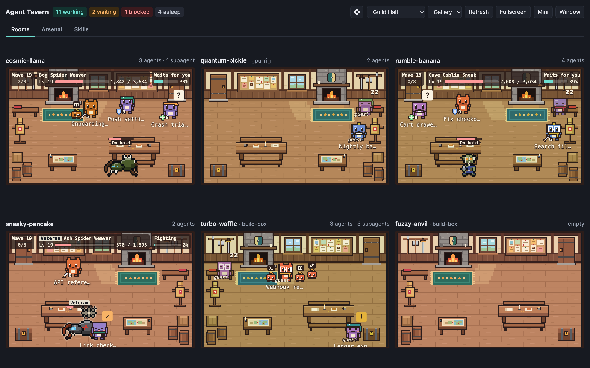

</div>

## Two ways to use it

| Just watch | Play |
|:---:|:---:|
| 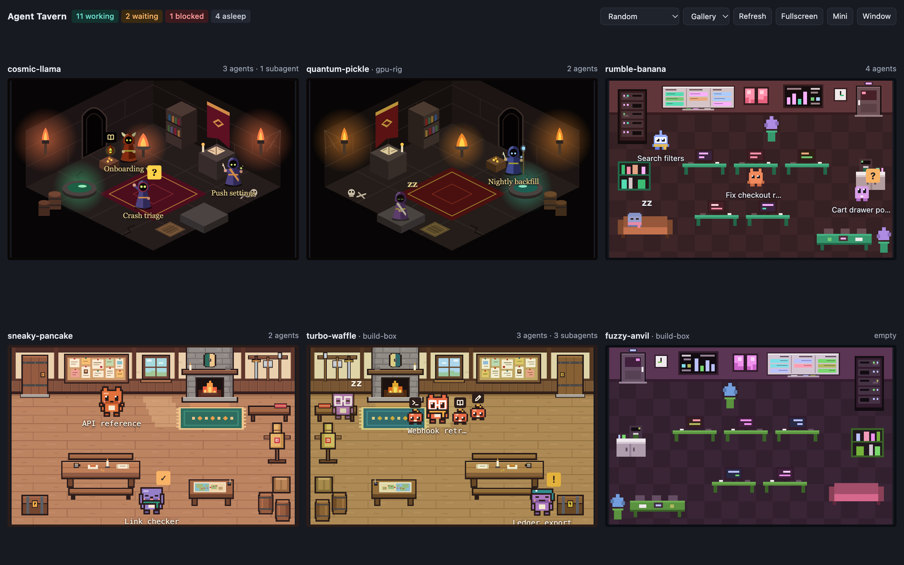 |  |
| **The default.** The rooms are a live picture of your agents and nothing else. No numbers, no progress, nothing to manage. One glance tells you who is busy, who is waiting on you and who has gone quiet. | **Game mode.** The same rooms become an auto-battler. Every agent is a character with a class and a level, the agents working in a room fight its monsters, the idle ones gather, and the loot buys gear. It plays by itself while you work. |

Game mode is off until you turn it on. Turning it off brings the plain rooms back and keeps
your progress for next time.

## The rooms

An agent editing files sits at a desk. One searching the codebase walks to the bookshelf. One
running a command stands at the server rack. When it needs you, it stops and raises a **?**. When
it is blocked, it stands under the build dashboard with a **!**. When it is done, it falls
asleep on the sofa. Subagents appear beside the agent that called them as its familiars, small companions in
its colours, and vanish when they finish.

One glance tells you which of your projects are busy, which are waiting on you, and which have
gone quiet, across every machine Orca is connected to.

- **One room per project.** Worktrees of the same repository share a room, and so does a
  repository cloned inside another one's folder. The room title shows the project and the host
  it runs on.
- **Activity, not just status.** Characters follow the tool their agent is using: writing,
  reading, running commands, delegating, waiting, blocked, done.
- **Subagents.** Every subagent is a familiar of the agent that called it: a small creature drawn
  by the room's theme, in that agent's colours. Familiars stay at their agent's side and follow
  it across the room, and a small icon over each shows what it is doing. Hover or click one for
  its name. An agent with more than six shows six and a "+N".
- **Finished, not seen yet.** An agent that finishes stays up with a "✓" and keeps
  celebrating for as long as Orca shows its bell. It goes to sleep once you have opened its
  terminal.
- **Emotes.** Now and then a character plays a short move that fits what it is doing and the
  room it is in: a spell cast over a long command, a stretch at the desk, a little dance on
  finishing. Never all at once, and not at all if your system asks for reduced motion.
- **Agents that were already running.** The plugin reads what is open in Orca when it starts,
  so the rooms are populated from the first second.
- **Every host.** Agents on paired machines get rooms too.
- **Everyone looks different.** Each agent gets its own outfit and tint, and each room its own
  colour, so you can tell them apart. They stay the same across restarts.
- **Themes.** Three ship with the plugin, each room can pick its own, and adding one is a
  folder with a few files.
- **Anywhere on screen.** A sidebar panel, a tab next to your terminals, a detached window,
  fullscreen on a spare monitor or tablet, or a small always-on-top window.

## Game mode: the auto-battler

You do not play it so much as feed it. Your agents do their work, and the work is what moves
the game: no clicking is needed, and nothing is lost by ignoring it for a day.

| Rooms | Chest | Skills | Market |
| --- | --- | --- | --- |
| 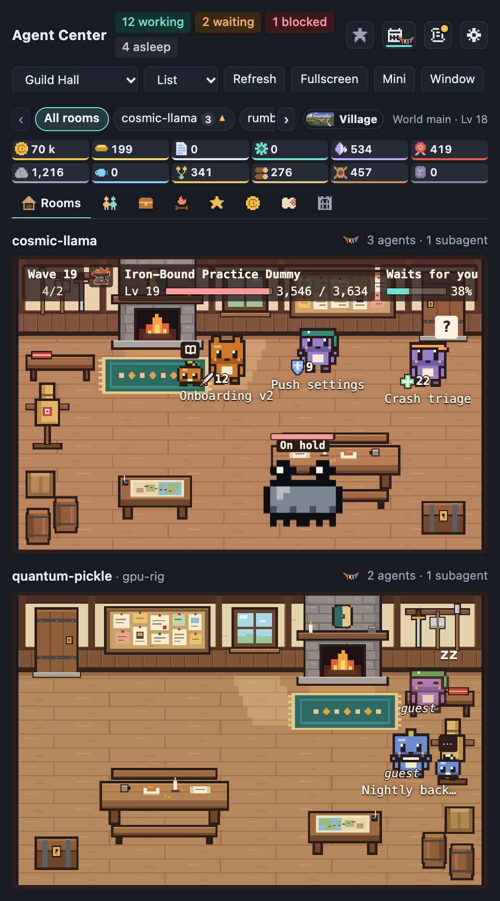 | 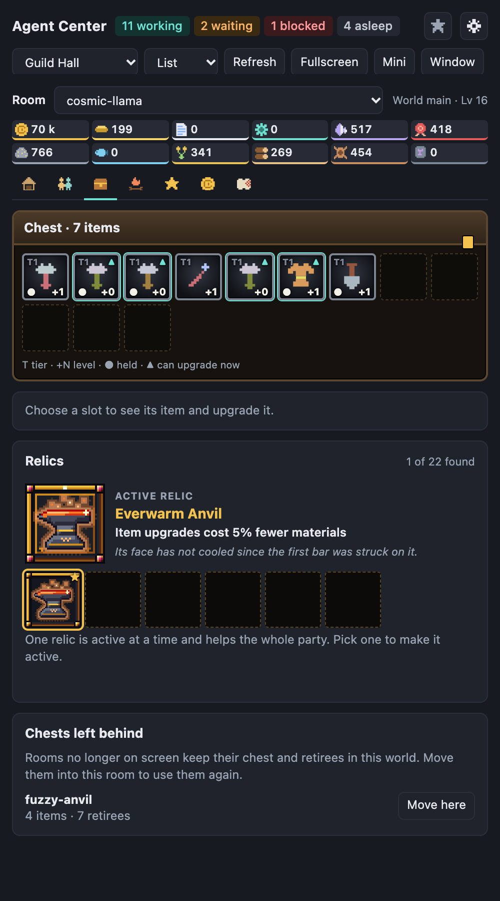 | 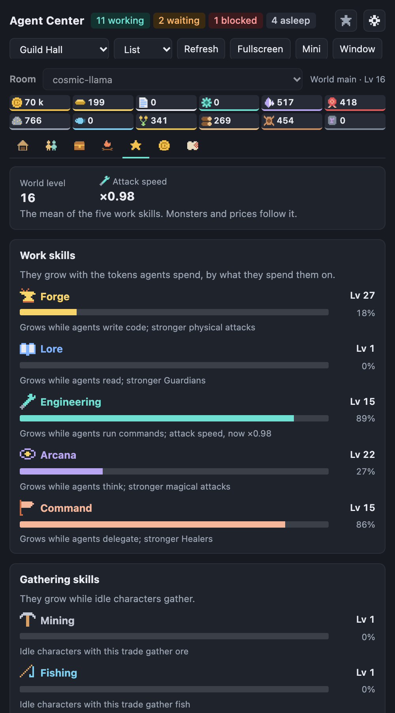 | 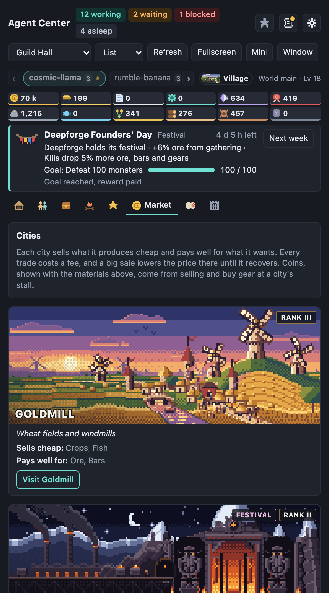 |

### How it plays

- **Every agent is a character.** A session gets a class when it first works (Fighter, Mage,
  Guardian or Healer, picked to balance its room's party), then levels up and grows seven
  attributes as it spends tokens. Click a character to see its sheet.
- **Each room is a party fighting waves.** The agents working in a room fight its monster.
  Every kill moves the wave on, every tenth wave brings a boss, and a party that runs out of
  stamina rests before it goes again. When an agent stops to wait for you, its party holds.
- **What your agents do decides what grows.** Writing code raises Forge, reading raises Lore,
  running commands raises Engineering, thinking raises Arcana and delegating raises Command.
  Each one makes a different part of the party stronger, and together they set the world level
  that monsters and prices follow.
- **Idle agents gather.** A character whose agent has finished takes a trade (mining, fishing,
  farming, woodcutting, hunting or runecraft) and brings materials home. The game picks one for
  each character (Auto); on the Party tab you can set what everyone in a room
  gathers, or what one character gathers, which wins over the room's choice.
- **Loot, a chest and upgrades.** Monsters drop materials and gear. Each room has a chest;
  a new character takes the best free item of each slot by itself. On the Party tab, click a
  character's slot to choose another item from the chest (or swap with whoever holds it); a
  slot chosen by hand stays as chosen until you set it back to Auto, and **Best gear for
  everyone here** re-picks every other slot. Materials upgrade items and
  buy upgrades for the whole party, by hand or with auto-spend.
- **A market with five cities.** Materials that pile up can be sold for coins or traded for
  ones you lack, in cities that open as the world grows: Goldmill, Deepforge, Brinehaven,
  Tallwood and Runespire. Each sells what it produces and pays best for what it wants; every
  trade costs a fee and a big sale lowers the price until it recovers, so trading never makes
  money out of nothing. Coins buy gear at a city's stall, new every day. Nothing is traded
  unless you do it.
- **Sessions retire.** Close a terminal and its character retires into the room's hall, leaves
  its gear in the chest for the next one and adds a small bonus to the room's gathering for
  good.
- **Worlds keep things apart.** Progress belongs to a world, a group of rooms you choose. Put
  work and side projects in different worlds, or leave a room out of the game altogether.
- **No level cap.** At level 99 a skill can be prestiged for a star and started again, stronger.
- **Legendary loot.** Bosses leave relics that help a room's whole party (one is active at a
  time; pick it on the Chest tab), and some named bosses guard a relic or a legendary weapon,
  outfit or tool of their own, with a buff for the character that holds it. A room's first boss
  always leaves a relic, and a city's stall sells one of its two relics now and then, for coins.
  They are a bonus on top: a full set adds well under a fifth to a party.
- **A bestiary.** Each world keeps a book of every creature it has fought: the Bestiary tab
  shows the races met and the bosses beaten (unknown ones as a dark silhouette and "???"), with
  kills, mastery levels and the next threshold. Every mastery level adds a little damage against
  that race, each race has a small perk of its own, and beating more different bosses levels a
  boss hunter track. It is a small bonus too: a whole bestiary adds under a tenth to a party.

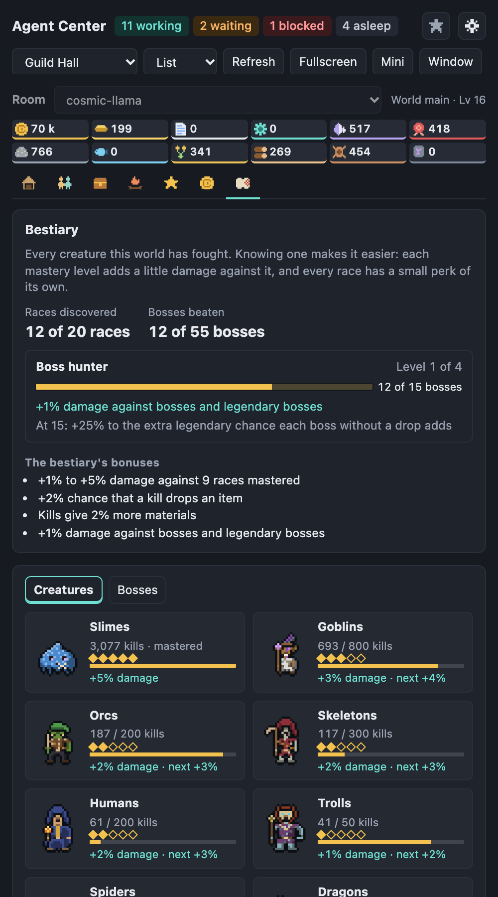

### The bestiary

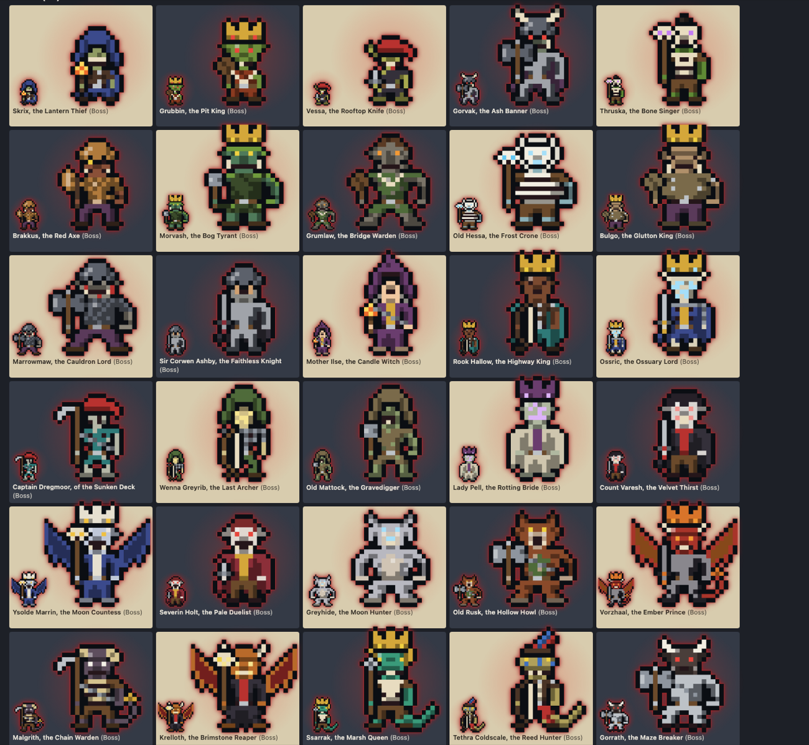

- **20 races**, from goblins, orcs and trolls to dragons, golems and wood wardens. A monster is
  put together from separate parts (head, body, legs, outfit, headgear, what it holds, colours),
  so two of the same race rarely look alike, and its name says what it is: a "Moss Troll
  Brute", an "Ashen Skeleton Archer".
- **55 named bosses**, each with a fixed look and a name of its own. A room meets all of them
  before any comes back.
- **Ranks you can read by the glow.** Most monsters are plain. A veteran has a faint outline,
  an elite a halo in the colour of its special trait, a champion a stronger one, a boss a red
  aura, and now and then a boss arrives legendary, in gold. The rarer the rank, the tougher the
  fight and the better the reward.
- A room's theme adds a few monsters of its own on top.
- **The party can travel.** Turn on **New scene after each monster** in the game's settings
  and every room that plays without a theme of its own moves on to another theme each time its
  monster dies, its party walking in as the old scene fades away. Each room goes through every
  theme before it sees one again, its monsters come from the scene it is in, and every surface
  shows the same scene. With only one theme installed it does nothing.

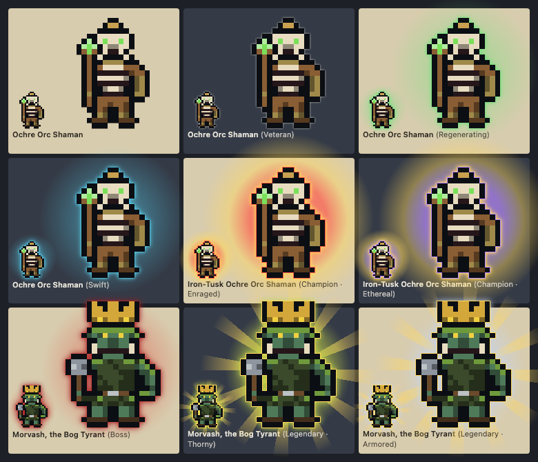

### Turning it on

Open Orca's Settings, go to Plugins, then Agent Center, and turn on **Game mode**. The panel
gains seven tabs: **Rooms**, **Party**, **Chest**, **Camp**, **Skills**, **Market** and **Bestiary**, under a
room picker and a strip with the world's coins and materials; the picker chooses the room that
Party and Chest show (and the world of the others), and on Rooms it can show one room alone. In
a narrow panel the tabs show their icons only. The cog in the
panel's header opens the game's own settings: auto-spend, **New scene after each monster**
(off by default; see "The party can travel" above), worlds and the save file.

**Game mode: keep conversation titles** keeps a finished session's title on its retired
character; it is off by default. Everything the game keeps stays on your computer. The full
rules and numbers are in [docs/GAME.md](docs/GAME.md).

### Good to know

Where the tokens come from:

- **Estimated, on today's Orca.** Released Orca versions do not give plugins the tokens a
  session spent. There, progress is estimated from how long each agent works and how many tool
  calls it makes; it is not measured. Each agent is one character for as long as its terminal is
  open, on this computer and on paired machines alike. A paired machine's agents are estimated
  from its snapshots alone, so more coarsely, and earn nothing while the machine cannot be
  reached. No new permission is asked for: the estimate uses only what the plugin already sees.
- **Real totals, once Orca provides them.** When Orca offers its Agent Session History to
  plugins and the session history permission (`history:read`) is granted, the game switches by
  itself to the real token totals. This version of the plugin does not ask for that permission
  yet.

The game's state says which one it is using (`tokenSource`). How the estimate is computed is in
[docs/GAME.md](docs/GAME.md#the-estimate).

To keep a copy of the game or carry it to another computer, open the game settings (the cog)
and use **Save file**: **Export** downloads the game as a JSON file and also shows it as text to
copy, since Orca's panel may block the download; **Import** takes such a file, chosen or pasted,
and replaces the whole game on this computer after asking. Token counts are not in the file, so
counting starts again from the import. The file is private: it holds your projects' folder
paths, the names of paired machines, session ids and, when titles are kept, conversation
titles. Do not attach it to a public bug report.

A room that is no longer on screen keeps its chest and retirees. The Chest tab
lists them under **Chests left behind** for the chosen room's world; **Move here** moves them
into that room after asking. Nothing moves by itself.

## Themes

Each room can use a different theme. The selector at the top sets the default, used by every
room that has not picked its own; hover a room's title to give that room its own.

Pick **Random** as the default to give each of those rooms a different theme instead of one
shared look. In game mode, **New scene after each monster** moves those rooms (under Random or
any other default) to a new theme with every kill instead. The choice comes from the room itself, so a room keeps its theme across restarts
and looks the same in the panel, the tab and the external view. Rooms are spread over the
themes as evenly as possible; opening a new project or adding a theme can move some of them.

| Pixel Dark | Guild Hall | Gothic Dungeon |
|:---:|:---:|:---:|
| 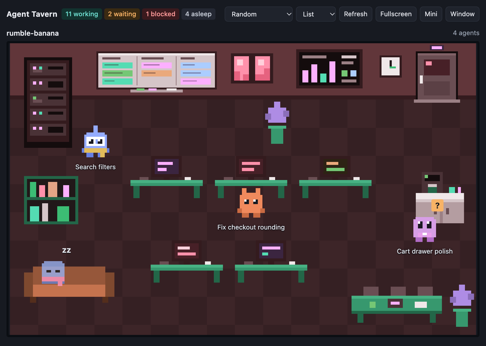 | 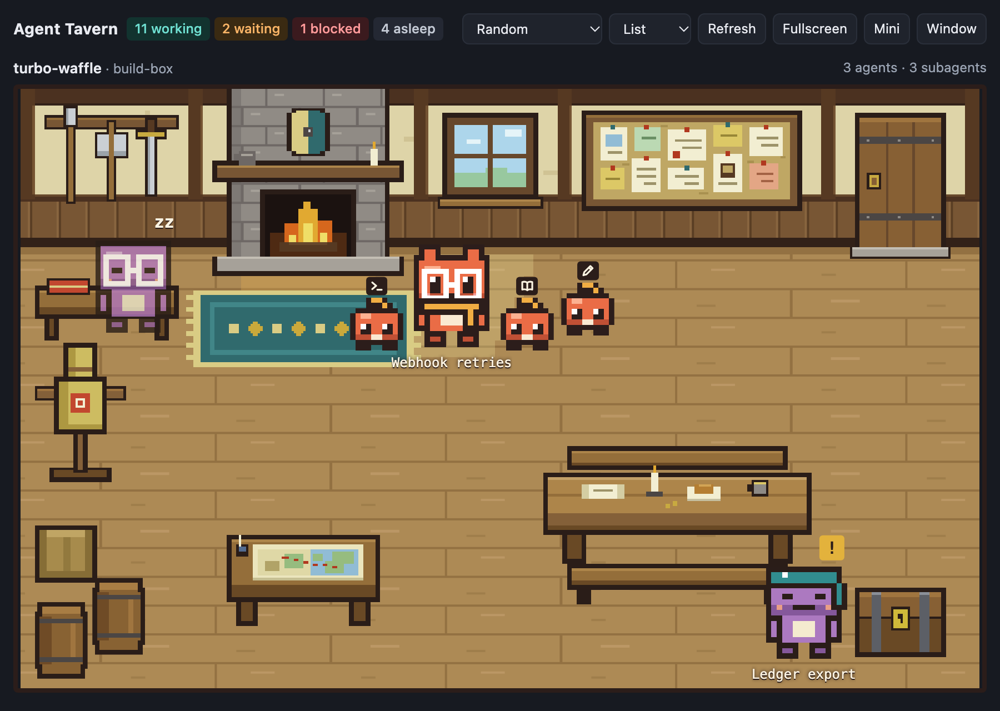 | 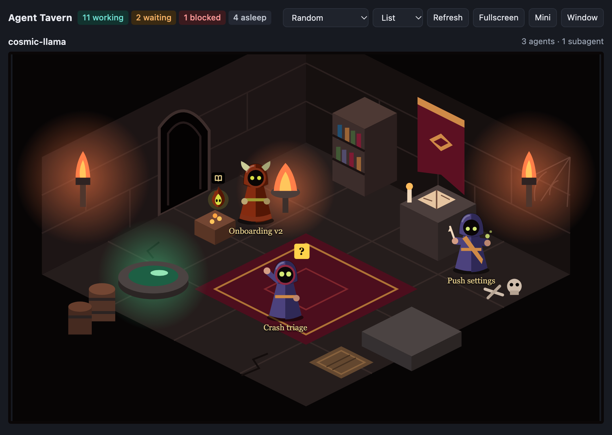 |
| A dark pixel-art office that blends into Orca. | A warm timber guild hall with a quest board, a fireplace and chunky outlined characters. | A torch-lit stone crypt with hooded figures. |

Want another look? A theme is a folder with a scenery, a sprite sheet and a small JSON file.
Copy `themes/_template`, run `node scripts/demo.mjs <your-theme>` and draw: the quick start in
[THEMES.md](THEMES.md#quick-start) has the six steps.

## Views

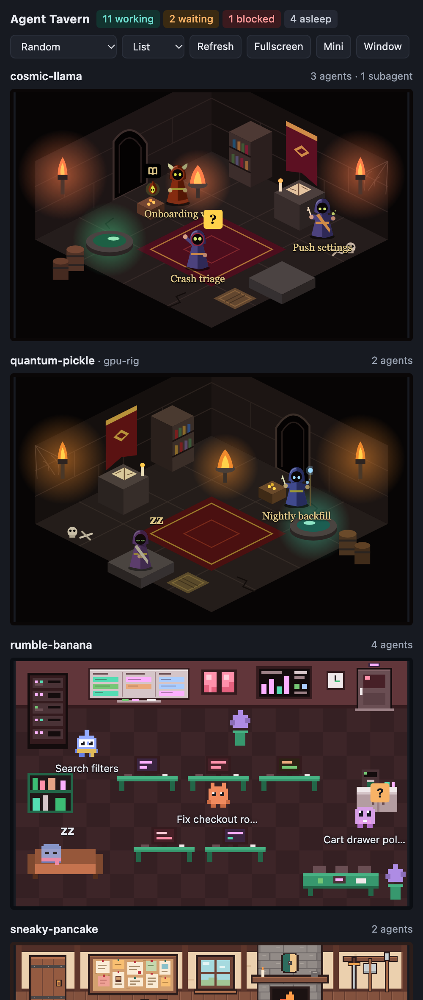

- **Gallery** fits every visible room in the space there is, with no scrolling. Good for a
  second monitor.
- **List** gives each room the full width and scrolls. Good for the sidebar.
- **Pin** a room in Gallery to show it large, with the others in a strip below. Hover the
  room's title and click **pin**; click **unpin** to go back.

The panel, the tab and the external view each remember their own choice.

The star at the right of the title opens the project's GitHub page, in case you want to leave a
star.

Rooms you do not care about can be hidden: hover the title and click **hide**. Hidden rooms are
listed at the bottom, one click away.

<br clear="right">

## Where it shows up

| Place | How to open it |
|---|---|
| Orca's sidebar | the **Agent Center** panel; **Collapse** leaves only the counters |
| A tab, next to the terminals | the tabs' **+** menu, **Agent Center** |
| Status bar | the item with the agent count shows or hides the sidebar |
| Detached window | **Pop out** opens the external view in your browser; there, **Window** |
| Fullscreen on another monitor | in the external view, **Fullscreen** |
| Mini, always on top | in the external view, **Mini** (Chrome or Edge) |

The external view is a local page the plugin serves at `http://127.0.0.1:47600/`, or on the next
free port when that one is taken; **Pop out** in the panel opens the right address. It takes a
few address options, handy for a wall display:

- `?view=gallery` or `?view=list` starts in that view.
- `?only=<text>` shows only the rooms whose project or host contains the text.
- `?emotes=off` keeps the characters from emoting; `?emotes=fast` makes them emote every few
  seconds, which is how you preview a theme's emotes.

To open it on a tablet on the same network, turn on **Open to the local network** in the plugin
settings and use the computer's IP address, or its name ending in `.local`, with the same port.
That option has no password, so anyone on the network can see your project, folder and agent
names and change the themes. In game mode they can watch the game but not play it: every game
control (spending, prestige, worlds, reset, auto-spend, keeping titles, export and import) works
only on the computer that runs Orca, and such a page shows **View only**. [SECURITY.md](SECURITY.md)
lists everything the page shows.

## Install

Find **Agent Center: Tavern & Auto-Battler** in Orca's plugin directory, or open its page:
<https://orca.dev/plugins/klausbegnis/agent-center>.

To run it from a checkout instead:

```bash
git clone https://github.com/klausbegnis/agent-center.git
```

```bash
orca plugin dev load ./agent-center
```

Orca lists what the plugin asks for and waits for your approval, because it runs its own code
and opens a local port. It needs Orca 1.4.248 or later.

## Try it without Orca

```bash
node scripts/demo.mjs
```

Opens the external view with a set of made-up projects and agents that keep working, delegating
and finishing. It is also the fastest way to see a theme while you draw it. The screenshots on
this page come from it.

```bash
GAME=1 node scripts/demo.mjs
```

Turns game mode on with a made-up stream of tokens. Add `FREEZE=1` for a fixed save after a day
of play.

```bash
GAME=1 TRAVEL=1 node scripts/demo.mjs random
```

Also turns on **New scene after each monster**, so each room changes scene with every kill. Name
`random` or a theme: without one, every demo room has a theme of its own and stays put.

## How it works

Two small programs that share one object, the view state:

- **The worker** (`src/`, Node, inside Orca) listens to Orca's agent events and tool hooks,
  reads what is already running through the `orca` CLI, and turns it all into rooms, agents and
  activities. `src/domain/` holds that logic with no I/O; `src/worker.mjs` only wires parts
  together.
- **The scene engine** (`ui/`, in the browser) draws the view state. It knows no theme: it
  reads `themes/<id>/theme.json` and draws what the file describes. The same engine runs in the
  panel, the tab and the external view.

There is no build step and there are no dependencies: the code runs as written.

```bash
npm run verify
```

Runs the static checks and the unit tests. `npm test` and `npm run check` run each alone.

## Contributing

Contributions are welcome.

- [CONTRIBUTING.md](CONTRIBUTING.md) takes you from a clone to a merged pull request.
- [rules/](rules/) holds the short rules the code follows, one file per area.
- [docs/MAINTAINING.md](docs/MAINTAINING.md) says how issues are triaged and pull requests
  merged.
- [CHANGELOG.md](CHANGELOG.md) lists what changed.

## Known limits

- Per-tool activity and subagents come from Orca's tool hooks, which do not cover agents on SSH
  or WSL hosts today. Those characters only show the overall state.
- With active subagents Orca does not say whose tool a call is. The plugin gives it to the most
  recent subagent, which is an approximation.
- The mapped tool names are Claude Code's and a few of Codex's. An unknown tool shows as
  "thinking".
- Agents on paired machines come without a conversation title, so they are labelled with the
  start of their last prompt.
- Reading through the CLI relies on the plugin's "runs its own code" grant rather than a
  dedicated capability. It only reads, apart from showing a terminal tab when you click
  "Open workspace".
- After Orca restarts, it stops tracking the sessions that were already running until they are
  started again. The plugin still shows them, recognised by their terminal title, but only as
  working or done: there is no per-tool activity, bell or familiar for them.
- Game mode's progress is an estimate on every released Orca: working time and tool calls stand
  in for tokens, and a conversation cleared in the same terminal goes on as the same character.
  See [docs/GAME.md](docs/GAME.md#the-estimate).
- On the estimate, an agent on a paired machine is seen only through its machine's snapshot
  every 15 seconds and no tool call of it is counted: its working time is sampled, and each
  working minute is paid at an assumed pace of tool calls. A long-running command there is
  overpaid like anywhere else.
- With real token totals, game mode counts only sessions on this computer: Orca's session
  history does not cover paired machines, and leaves subagents out. Agents on paired machines
  then join their room's fight as guests with no token count, and a room whose only agents are
  guests does not join the game. Under the Random theme the game uses its generic monsters,
  except in rooms that travel with **New scene after each monster**, whose monsters come from
  their scene.
- With **New scene after each monster**, adding or removing a theme changes the order the rooms
  travel in, and the monster standing when the setting is turned on keeps its look until it
  dies.
- macOS and Linux are what it is tested on. On Windows the plugin loads, but it does not find
  the Orca CLI yet, so agents that were already running, paired machines, the bell and "Open
  workspace" on a terminal are missing.

## Licence

[MIT](LICENSE)
