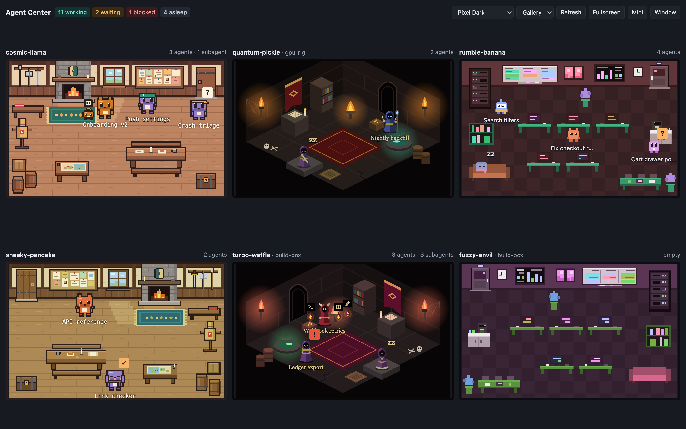
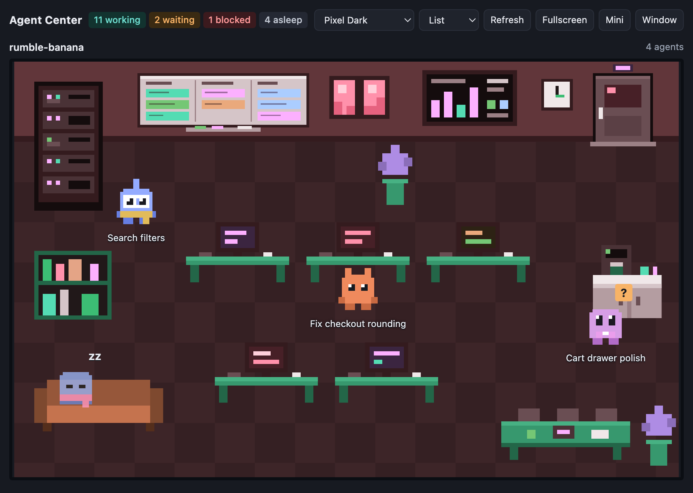
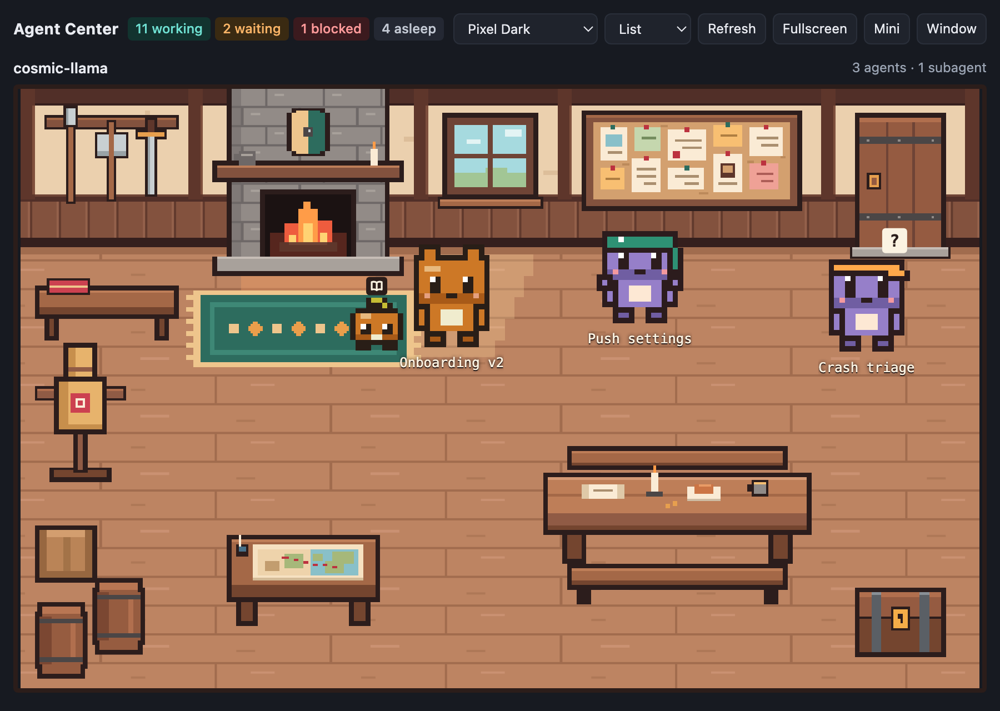
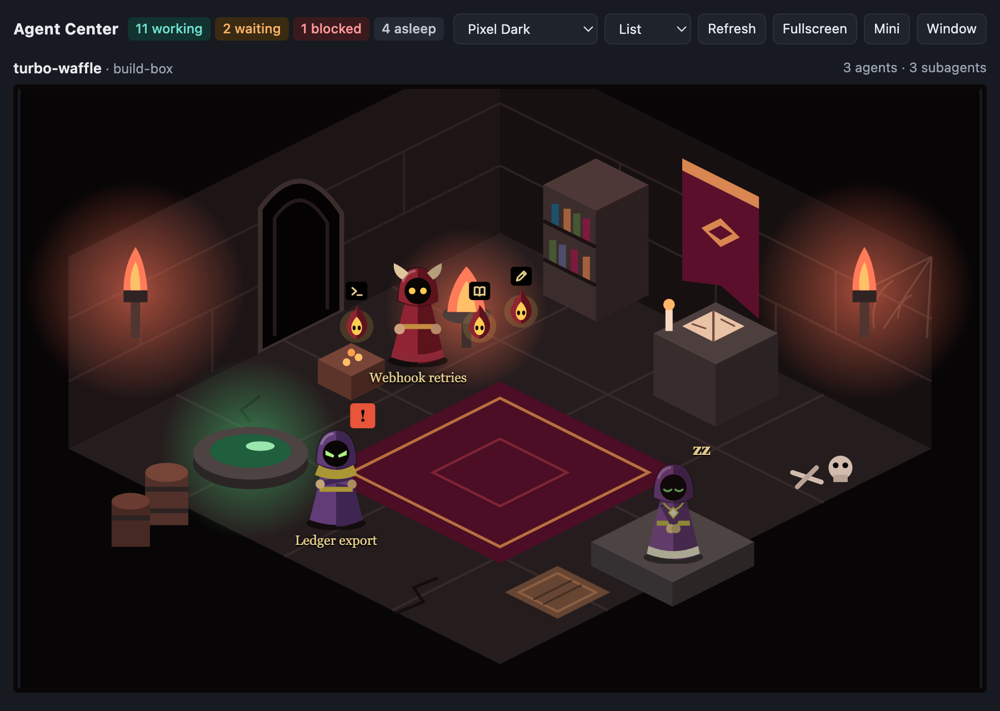
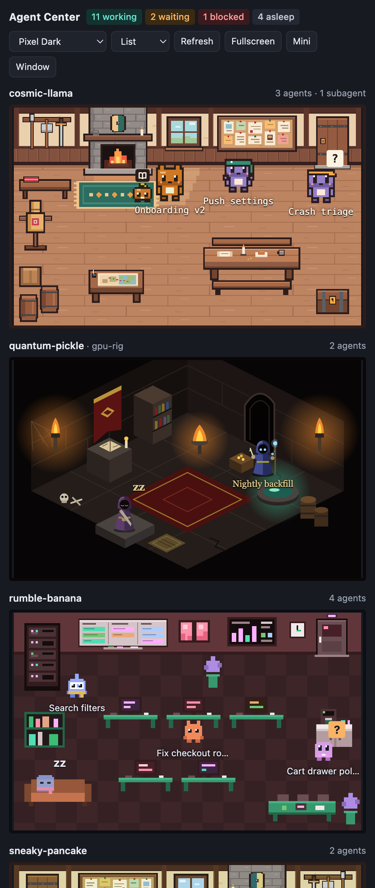

<div align="center">

# Agent Center

**See your coding agents at work.** A plugin for [Orca](https://github.com/stablyai/orca) that
gives every project its own little room, where each agent is a character acting out what it is
doing right now.



</div>

An agent editing files sits at a desk. One searching the codebase walks to the bookshelf. One
running a command stands at the server rack. When it needs you, it stops and raises a **?**. When
it is blocked, it stands under the build dashboard with a **!**. When it is done, it falls
asleep on the sofa. Subagents appear beside the agent that called them as its familiars, small companions in
its colours, and vanish when they finish.

One glance tells you which of your projects are busy, which are waiting on you, and which have
gone quiet, across every machine Orca is connected to.

## What you get

- **One room per project.** Worktrees of the same repository share a room, and so does a
  repository cloned inside another one's folder. The room title shows the project and the host
  it runs on.
- **Activity, not just status.** Characters follow the tool their agent is using: writing,
  reading, running commands, delegating, waiting, blocked, done.
- **Subagents.** Every subagent is a familiar of the agent that called it: a small creature drawn
  by the room's theme, in that agent's colours. Familiars stay at their agent's side and follow
  it across the room, and a small icon over each shows what it is doing. Hover or click one for
  its name. An agent with more than six shows six and a "+N".
- **Finished, not seen yet.** An agent that finishes stays up with a "✓" and keeps
  celebrating for as long as Orca shows its bell. It goes to sleep once you have opened its
  terminal.
- **Emotes.** Now and then a character plays a short move that fits what it is doing and the
  room it is in: a spell cast over a long command, a stretch at the desk, a little dance on
  finishing. Never all at once, and not at all if your system asks for reduced motion.
- **Agents that were already running.** The plugin reads what is open in Orca when it starts,
  so the rooms are populated from the first second.
- **Every host.** Agents on paired machines get rooms too.
- **Everyone looks different.** Each agent gets its own outfit and tint, and each room its own
  colour, so you can tell them apart. They stay the same across restarts.
- **Themes.** Three ship with the plugin, each room can pick its own, and adding one is a
  folder with a few files.
- **Anywhere on screen.** A sidebar panel, a tab next to your terminals, a detached window,
  fullscreen on a spare monitor or tablet, or a small always-on-top window.

## Themes

Each room can use a different theme. The selector at the top sets the default, used by every
room that has not picked its own; hover a room's title to give that room its own.

Pick **Random** as the default to give each of those rooms a different theme instead of one
shared look. The choice comes from the room itself, so a room keeps its theme across restarts
and looks the same in the panel, the tab and the external view. Rooms are spread over the
themes as evenly as possible; opening a new project or adding a theme can move some of them.

| Pixel Dark | Guild Hall | Gothic Dungeon |
|:---:|:---:|:---:|
|  |  |  |
| A dark pixel-art office that blends into Orca. | A warm timber guild hall with a quest board, a fireplace and chunky outlined characters. | A torch-lit stone crypt with hooded figures. |

Want another look? A theme is a folder with a scenery, a sprite sheet and a small JSON file.
Copy `themes/_template`, run `node scripts/demo.mjs <your-theme>` and draw: the quick start in
[THEMES.md](THEMES.md#quick-start) has the six steps.

## Views



- **Gallery** fits every visible room in the space there is, with no scrolling. Good for a
  second monitor.
- **List** gives each room the full width and scrolls. Good for the sidebar.
- **Pin** a room in Gallery to show it large, with the others in a strip below. Hover the
  room's title and click **pin**; click **unpin** to go back.

The panel, the tab and the external view each remember their own choice.

Rooms you do not care about can be hidden: hover the title and click **hide**. Hidden rooms are
listed at the bottom, one click away.

<br clear="right">

## Where it shows up

| Place | How to open it |
|---|---|
| Orca's sidebar | the **Agent Center** panel; **Collapse** leaves only the counters |
| A tab, next to the terminals | the tabs' **+** menu, **Agent Center** |
| Status bar | the item with the agent count shows or hides the sidebar |
| Detached window | **Pop out** opens the external view in your browser; there, **Window** |
| Fullscreen on another monitor | in the external view, **Fullscreen** |
| Mini, always on top | in the external view, **Mini** (Chrome or Edge) |

The external view is a local page the plugin serves at `http://127.0.0.1:47600/`, or on the next
free port when that one is taken; **Pop out** in the panel opens the right address. It takes a
few address options, handy for a wall display:

- `?view=gallery` or `?view=list` starts in that view.
- `?only=<text>` shows only the rooms whose project or host contains the text.
- `?emotes=off` keeps the characters from emoting; `?emotes=fast` makes them emote every few
  seconds, which is how you preview a theme's emotes.

To open it on a tablet on the same network, turn on **Open to the local network** in the plugin
settings and use the computer's IP address, or its name ending in `.local`, with the same port.
That option has no password, so anyone on the network can see your project, folder and agent
names and change the themes. [SECURITY.md](SECURITY.md) lists everything the page shows.

## Install

Agent Center is not in a catalog yet. Load it from a checkout:

```bash
git clone https://github.com/klausbegnis/agent-center.git
```

```bash
orca plugin dev load ./agent-center
```

Orca lists what the plugin asks for and waits for your approval, because it runs its own code
and opens a local port. It needs Orca 1.4.248 or later.

## Try it without Orca

```bash
node scripts/demo.mjs
```

Opens the external view with a set of made-up projects and agents that keep working, delegating
and finishing. It is also the fastest way to see a theme while you draw it. The screenshots on
this page come from it.

## How it works

Two small programs that share one object, the view state:

- **The worker** (`src/`, Node, inside Orca) listens to Orca's agent events and tool hooks,
  reads what is already running through the `orca` CLI, and turns it all into rooms, agents and
  activities. `src/domain/` holds that logic with no I/O; `src/worker.mjs` only wires parts
  together.
- **The scene engine** (`ui/`, in the browser) draws the view state. It knows no theme: it
  reads `themes/<id>/theme.json` and draws what the file describes. The same engine runs in the
  panel, the tab and the external view.

There is no build step and there are no dependencies: the code runs as written.

```bash
npm run verify
```

Runs the static checks and the unit tests. `npm test` and `npm run check` run each alone.

## Contributing

Contributions are welcome.

- [CONTRIBUTING.md](CONTRIBUTING.md) takes you from a clone to a merged pull request.
- [rules/](rules/) holds the short rules the code follows, one file per area.
- [docs/MAINTAINING.md](docs/MAINTAINING.md) says how issues are triaged and pull requests
  merged.
- [CHANGELOG.md](CHANGELOG.md) lists what changed.

## Known limits

- Per-tool activity and subagents come from Orca's tool hooks, which do not cover agents on SSH
  or WSL hosts today. Those characters only show the overall state.
- With active subagents Orca does not say whose tool a call is. The plugin gives it to the most
  recent subagent, which is an approximation.
- The mapped tool names are Claude Code's and a few of Codex's. An unknown tool shows as
  "thinking".
- Agents on paired machines come without a conversation title, so they are labelled with the
  start of their last prompt.
- Reading through the CLI relies on the plugin's "runs its own code" grant rather than a
  dedicated capability. It only reads, apart from showing a terminal tab when you click
  "Open workspace".
- After Orca restarts, it stops tracking the sessions that were already running until they are
  started again. The plugin still shows them, recognised by their terminal title, but only as
  working or done: there is no per-tool activity, bell or familiar for them.
- macOS and Linux are what it is tested on. On Windows the plugin loads, but it does not find
  the Orca CLI yet, so agents that were already running, paired machines, the bell and "Open
  workspace" on a terminal are missing, and the links `.claude/rules` and `.agents/rules` need
  symlinks turned on in git.

## Licence

[MIT](LICENSE)
